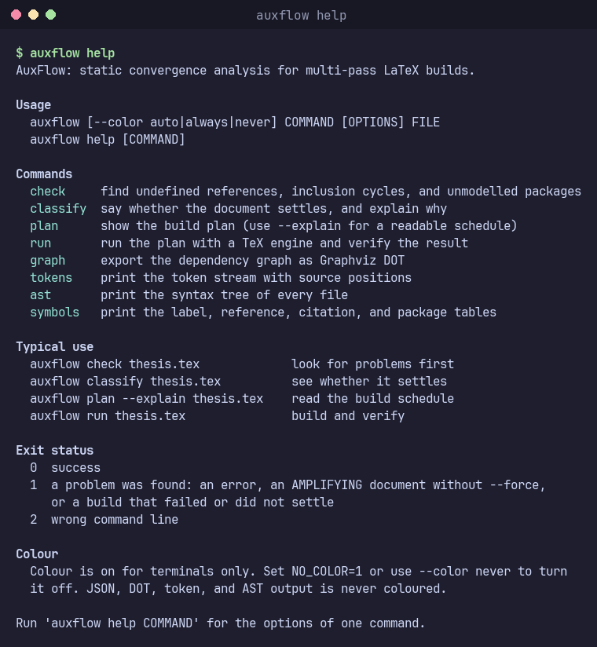
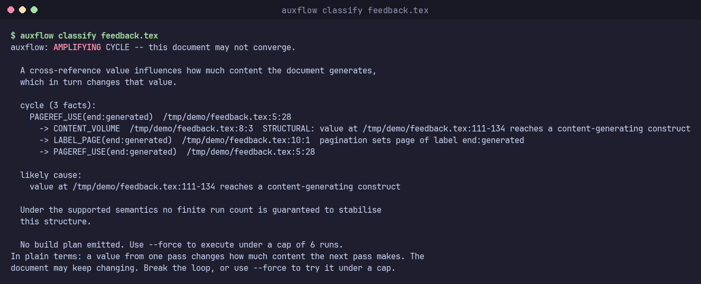

# AuxFlow

Static analysis and build planning for multi-pass document compilation.

AuxFlow is a compiler and static analyzer for LaTeX documents. It builds an instance-level dependency graph of cross-references, detects feedback cycles, and predicts how many passes the document needs to stabilize. All static checks complete before the typesetting engine runs.

---

## Overview

Document compilers like LaTeX are multi-pass systems. They write cross-references, table of contents entries, and citations to auxiliary files. The engine reads these files on subsequent passes to resolve references.

Most build tools discover the required pass count dynamically. They run the engine repeatedly until auxiliary files stop changing, or they apply a fixed schedule.

AuxFlow takes a compiler approach:

1. It parses the LaTeX source once into an Abstract Syntax Tree (AST).
2. It resolves label, reference, and citation symbols across all files.
3. It constructs an Intermediate Representation called the Auxiliary Reference Graph (ARG).
4. It detects cycles with Tarjan's strongly connected components algorithm.
5. It tracks values that affect document length using forward taint analysis.
6. It classifies document convergence and generates an optimized build plan.

---

## How It Works

AuxFlow implements a complete compiler pipeline:

```
                Source (LaTeX subset)
                          |
                          v
                        Lexer                 Category codes 0-15
                          |
                          v
                       Parser                 Recursive descent (1-token lookahead)
                          |
                          v
                         AST                  Multi-file forest and inclusion graph
                          |
                          v
                 Semantic Analysis            Symbol tables and static diagnostics
                          |
                          v
            Auxiliary Reference Graph (ARG)   Fact instances with lagged typed edges
                          |
                          v
                 Static Taint Analysis        Forward reachability to content volume
                          |
                          v
               SCC and Fixpoint Analysis      Tarjan SCC, stable-pass recurrence
                          |
                          v
                   Classification             CERTIFIED, BENIGN_CYCLIC, AMPLIFYING, UNKNOWN
                          |
                          v
                     Build Plan               Optimized schedule with tool elimination
                          |
                          v
                Runtime Verification          Normalized auxiliary fixpoint check
```

### 1. Lexer and Parser
The lexer implements the sixteen TeX category codes in a single-pass scanner. It preserves source locations and tracks comments and verbatim blocks. The recursive-descent parser uses a signature table for macro arguments. It recovers from malformed input without stopping.

### 2. Multi-File Symbol Resolution
The semantic analyzer resolves cross-references with a two-pass algorithm. The declare pass records all definitions. The resolve pass binds uses across file boundaries.

### 3. The Auxiliary Reference Graph (ARG)
The ARG is AuxFlow's Intermediate Representation. Each vertex is a concrete fact instance with an exact source location. Edges carry dependency types and pass lags:
- `AUX_ROUNDTRIP` (lag 1): Reads a fact written during the previous run.
- `TOOL` (lag 1): Represents external tools like BibTeX.
- `LAYOUT` (lag 0 or 1): Models pagination and list extents.

List entries split into `exists` (structural presence) and `value` (typeset page) facts. This separation keeps standard documents acyclic.

### 4. Convergence Classification
Documents classify into one of four states:
- **`CERTIFIED`**: Acyclic dependency structure. Settle within a derived pass count ($P + 1$).
- **`BENIGN_CYCLIC`**: Value-only cycles. Settle safely without changing document content volume.
- **`AMPLIFYING`**: Reference values control content generation. May diverge infinitely. Refused by default.
- **`UNKNOWN`**: Contains unmodelled packages or macros. Falls back to a conservative default schedule.

### 5. Build Planner and Runtime Verifier
The planner removes unused files and unnecessary tool invocations. It derives the minimal engine run count for certified documents. At runtime, the verifier normalizes auxiliary files into canonical records and checks for a genuine fixpoint.

---

## CLI Usage

Python 3.12 or later is required. On systems with an externally managed Python (for example Arch Linux), install into a virtual environment:

```bash
python -m venv .venv
source .venv/bin/activate        # bash or zsh
source .venv/bin/activate.fish   # fish
pip install -e ".[dev]"
```

The prompt shows `(.venv)` after activation. Use `pip install -e .` instead if you do not need the test, type-check, and lint tools. To skip activation, call `.venv/bin/auxflow` directly.

Check the install:

```bash
auxflow classify bench/corpus/b01_plain/main.tex
```

Inspect the compiler pipeline on any document:

```bash
# Print tokens with source positions
auxflow tokens document.tex

# View the multi-file AST
auxflow ast document.tex

# Inspect symbol tables (labels, refs, cites, packages)
auxflow symbols document.tex

# Run zero-engine semantic checks
auxflow check document.tex

# Export the Auxiliary Reference Graph in Graphviz DOT format
auxflow graph document.tex

# Classify document convergence
auxflow classify document.tex

# Inspect the generated build plan
auxflow plan --explain document.tex

# Execute the plan with runtime verification
auxflow run document.tex
```

Human-readable output is coloured when it goes to a terminal. Set `NO_COLOR=1` or pass `--color never` to turn colour off. Pass `--color always` to keep it in a pipe. JSON, DOT, token and AST output is never coloured. `classify` ends with a short "In plain terms" sentence. `check` and `run` print a one-line summary on stderr, so stdout stays machine-readable.

Run `auxflow help` for an overview of every command, typical use, and exit codes. Run `auxflow help COMMAND` for the options of one command.





The images show real command output rendered from a pseudo-terminal.

## Quick demonstrations

The [quickstart examples](examples/quickstart/README.md) show a certified reference,
a multi-file contents list, and a document with an amplifying cycle.
The examples include commands and expected classifications.

For a project with a custom class or packages, start with `auxflow check FILE` and
`auxflow classify FILE`. UNKNOWN means that AuxFlow cannot establish the static bound.
It does not mean the document fails to compile. Do not treat package discovery as
proof that a package's typesetting effects are modelled.

---

## Benchmark Corpus and Evaluation

The repository includes a 15-member benchmark corpus (`bench/corpus/`) covering non-convergence mechanisms and standard document structures:

- Monotone divergence loops (Gaspar 2014)
- Line-break width feedback oscillations
- Float placement oscillations
- Dynamic textual references (`varioref`)
- Conditional font size switches (`ifthenelse`)
- Same-page citation feedback (`biblatex`)
- Realistic multi-chapter thesis with table of contents, lists, and bibliography

Run the end-to-end demonstration script:

```bash
bash bench/demo.sh
```

Full experimental data from 1,050 containerized runs across 7 baselines is documented in [docs/EVALUATION-REPORT.md](docs/EVALUATION-REPORT.md) and [docs/GATE-REPORT.md](docs/GATE-REPORT.md).

---

## Documentation

| Document | Description |
|---|---|
| [docs/PROJECT.md](docs/PROJECT.md) | Project specification and open decisions |
| [docs/COMPILER-PIPELINE.md](docs/COMPILER-PIPELINE.md) | Detailed compiler phase descriptions and algorithms |
| [docs/LANGUAGE-SUBSET.md](docs/LANGUAGE-SUBSET.md) | Supported LaTeX subset and fallback policies |
| [docs/IR.md](docs/IR.md) | Auxiliary Reference Graph specification |
| [docs/STATIC-ANALYSIS.md](docs/STATIC-ANALYSIS.md) | Taint analysis, SCC algorithms, and stable-pass recurrence |
| [docs/NON-CONVERGENCE.md](docs/NON-CONVERGENCE.md) | Diagnostic format and error reporting |
| [docs/BUILD-PLANNER.md](docs/BUILD-PLANNER.md) | Plan lowering passes and safety invariants |
| [docs/RUNTIME-VERIFICATION.md](docs/RUNTIME-VERIFICATION.md) | Canonical state normalization and fixpoint detection |
| [docs/BENCHMARKS.md](docs/BENCHMARKS.md) | Benchmark corpus design and oracle specifications |
| [docs/EVALUATION.md](docs/EVALUATION.md) | Measurement methodology and baselines |
| [docs/EVALUATION-REPORT.md](docs/EVALUATION-REPORT.md) | Full empirical evaluation results |
| [docs/GATE-REPORT.md](docs/GATE-REPORT.md) | Verification results for Gate 1 and Gate 2 |
| [docs/RELATED-WORK.md](docs/RELATED-WORK.md) | Literature review and technical comparison |

---

## License

MIT. See [LICENSE](LICENSE).
