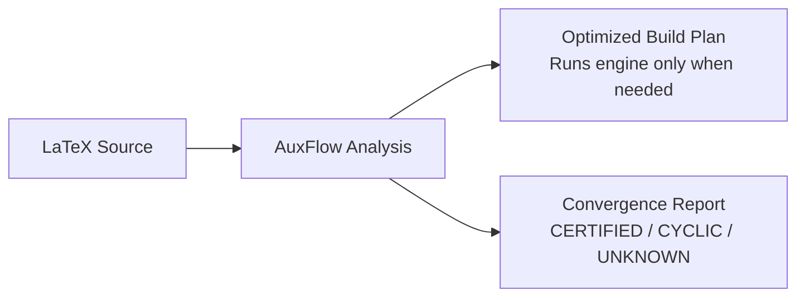

# AuxFlow

A compiler and static analysis tool for LaTeX documents.

[](https://pypi.org/project/auxflow/) [](https://pypi.org/project/auxflow/)

LaTeX documents often compile multiple times to settle page numbers, tables of contents, and citations.
Standard tools rerun the engine until auxiliary files stop changing.
AuxFlow inspects your code upfront, finds reference loops, and calculates the exact compile passes needed.



---

## Installation

Install with `pipx` (recommended for command-line tools):

```bash
pipx install auxflow
pipx ensurepath
```

Or install with `pip`:

```bash
pip install --user auxflow
```

The optional [installer script](https://github.com/upayanmazumder/auxflow/blob/main/install.sh) installs the published package and may edit your shell profiles. Inspect it before running it. Do not pipe a network download into a shell.

Requires Python 3.12 or newer.

---

## Quick Start

Check a document for broken references and syntax errors:

```bash
auxflow check document.tex
```

Find the number of compile passes needed:

```bash
auxflow classify document.tex
```

Build the document with automatic verification:

```bash
auxflow run document.tex
```

`auxflow run` starts local TeX tools. Run only documents and packages you trust. It is not a sandbox. Each tool has a 600-second limit by default. Use `auxflow run --timeout 30 document.tex` to change that limit.

Check for a published update without installing it:

```bash
auxflow update --check
```

Run `auxflow update` to install a newer release into the current Python environment.
Editable installations require a manual package-manager update.
Normal commands can show a cached update notice on stderr.
AuxFlow checks PyPI at most daily while a command runs, without waiting for the network.
Short commands may finish before that check completes. No background service remains running.
Set `AUXFLOW_NO_UPDATE_CHECK=1` to disable automatic checks.

View system info and project links:

```bash
auxflow info
```

Show command options and usage:

```bash
auxflow help
```

Check that TeX is installed and see how AuxFlow is set up:

```bash
auxflow doctor
```

`auxflow check`, `auxflow classify`, and `auxflow plan` accept `--json` for editors and CI.
Locations print as `file:line:column`. Paths under the current directory print relative to it.
`auxflow --quiet COMMAND` hides progress, next-step hints, and update notices.
Results and errors still print, so scripts can rely on the output and the exit status.

---

## Document States

AuxFlow assigns every document one of four convergence states:

| State | What it means |
|:---|:---|
| **CERTIFIED** | Stable reference structure. Needs a fixed number of runs. |
| **BENIGN_CYCLIC** | Loops exist, but do not change content length. Settles safely. |
| **AMPLIFYING** | Loops trigger infinite page growth. Refused by default. |
| **UNKNOWN** | Uses packages outside the supported subset. Uses safe default runs. |

---

## Documentation

Browse the sections in the sidebar:

- **[Reference](/reference/)**: Compiler phases, supported LaTeX subset, and dependency graph models.
- **[Project](/project/)**: Formal specification, research questions, and literature comparison.
- **[Evaluation](/evaluation/)**: 15-document benchmark corpus, test setup, and experimental results.
- **[Paper](/paper/)**: The research paper (PDF) with its method, measurements, and limits.
- **[Reviews](/reviews/)**: Viva defense notes, slide presentations, and assessment documents.
- **[Changelog](/changelog.html)**: Interactive release notes and update history.
