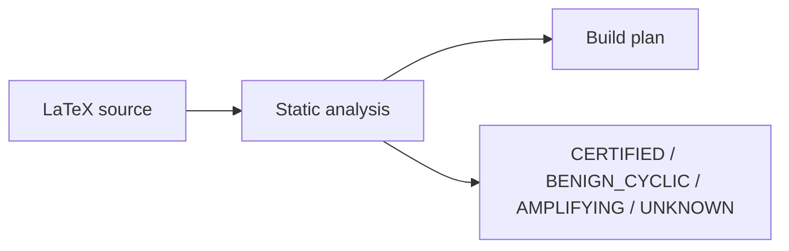

# AuxFlow

A compiler and static analysis tool for LaTeX documents.

[](https://pypi.org/project/auxflow/) [](https://pypi.org/project/auxflow/)

LaTeX often needs several runs to settle page numbers, contents, and citations.
AuxFlow analyzes a declared subset before TeX runs. It reports cycles and
computes a conservative pass bound when its model can certify the document.
The runtime verifier checks the actual auxiliary files.



---

## Installation

Install with `pipx` (recommended for command-line tools):

```bash
pipx install auxflow
pipx ensurepath
```

Or install with `pip`:

```bash
pip install --user auxflow
```

The optional [installer script](https://github.com/upayanmazumder/auxflow/blob/main/install.sh) installs the published package and may edit your shell profiles. Inspect it before running it. Do not pipe a network download into a shell.

Requires Python 3.12 or newer.

---

## Quick Start

Check a document for broken references and syntax errors:

```bash
auxflow check document.tex
```

Find the number of compile passes needed:

```bash
auxflow classify document.tex
```

Build the document with automatic verification:

```bash
auxflow run document.tex
```

`auxflow run` starts local TeX tools. Run only documents and packages you trust. It is not a sandbox. Each tool has a 600-second limit by default. Use `auxflow run --timeout 30 document.tex` to change that limit.

Check for a published update without installing it:

```bash
auxflow update --check
```

Run `auxflow update` to install a newer release into the current Python environment.
Editable installations require a manual package-manager update.
Normal commands can show a cached update notice on stderr.
AuxFlow checks PyPI at most daily while a command runs, without waiting for the network.
Short commands may finish before that check completes. No background service remains running.
Set `AUXFLOW_NO_UPDATE_CHECK=1` to disable automatic checks.

View system info and project links:

```bash
auxflow info
```

Show command options and usage:

```bash
auxflow help
```

Check that TeX is installed and see how AuxFlow is set up:

```bash
auxflow doctor
```

`auxflow check`, `auxflow classify`, and `auxflow plan` accept `--json` for editors and CI.
Locations print as `file:line:column`. Paths under the current directory print relative to it.
`auxflow --quiet COMMAND` hides progress, next-step hints, and update notices.
Results and errors still print, so scripts can rely on the output and the exit status.

---

## VS Code extension

Download the VSIX from the [GitHub Releases page](https://github.com/upayanmazumder/auxflow/releases). Install it with VS Code's **Extensions: Install from VSIX...** command. Future `vX.Y.Z` releases attach a wheel, source distribution, and VSIX. The workflow checks Python and the extension before publication. It sets the extension version from the release tag and saves that version to `main`.

The `v0.1.0` and `v0.4.0` VSIX files were added after the Python releases. They bundle newer analyzer code. Later releases build all assets from the same tag.

To update, install the newer VSIX manually. The Marketplace does not provide updates for this extension. The [extension guide](https://github.com/upayanmazumder/auxflow/blob/main/extension/README.md) covers settings. The extension bundles the analyzer but requires Python 3.12 or newer on the extension host. A separate AuxFlow installation is unnecessary.

Checks of open `.tex` documents use unsaved contents after a debounce. Set `auxflow.mainFile` to a workspace-relative main file for included sources; otherwise the active file is the root. Warnings appear in Problems, and the static classification appears in the status bar. The extension does not run TeX. `UNKNOWN` indicates insufficient static knowledge, not proof of non-convergence. See [package and class limits](/reference/package-support.html).

## Document States

AuxFlow assigns one of four states from its static model:

| State             | What it means                                                                                               |
| :---------------- | :---------------------------------------------------------------------------------------------------------- |
| **CERTIFIED**     | The model gives a conservative pass bound. Runtime still verifies it.                                       |
| **BENIGN_CYCLIC** | The model finds a cycle without a structural edge. Convergence is not guaranteed.                           |
| **AMPLIFYING**    | A value may change the amount of generated content. Refused by default.                                     |
| **UNKNOWN**       | Unsupported syntax, packages, or a local class prevent certification. This is not proof of non-convergence. |

## Packages, classes, and bundles

AuxFlow recognizes `graphicx`, `varioref`, and `ifthen` for limited constructs.
It treats `inputenc`, `fontenc`, `ae`, `aecompl`, `lmodern`, `xcolor`,
`parskip`, `geometry`, `setspace`, `multicol`, and `amsmath` as inert for
auxiliary-state analysis. An accepted name does not make all its commands
or layout effects safe. Other direct package names make classification `UNKNOWN`.
AuxFlow checks comma-separated package names individually. It does not certify
TeX Live bundles as a unit.

A local `.cls` file makes the document `UNKNOWN`. A nonstandard external class
can produce a warning without changing classification. The
[package and class reference](/reference/package-support.html) gives the exact
list, limits, and diagnosis commands.

## Demo documents

The [quickstart files](https://github.com/upayanmazumder/auxflow/tree/main/examples/quickstart)
show a reference, a multi-file build, an amplifying cycle, and a local class.
The [15-document corpus](https://github.com/upayanmazumder/auxflow/tree/main/bench/corpus)
also includes deliberate failure cases. Run these commands from the repository root:

```sh
auxflow classify examples/quickstart/simple.tex
auxflow plan --explain examples/quickstart/multifile/main.tex
auxflow classify bench/corpus/b08_cycle/main.tex
```

The last command reports `AMPLIFYING` and exits with status 1. Do not use
`--force` for that demo. Three corpus cases exposed false negatives before
guards changed their classifications to `UNKNOWN`. Read the
[benchmark results](/evaluation/benchmarks.html) before treating any
`CERTIFIED` result as a general convergence guarantee.

---

## Documentation

Browse the sections in the sidebar:

- **[Reference](/reference/)**: Compiler phases, supported LaTeX subset, and dependency graph models.
- **[Project](/project/)**: Formal specification, research questions, and literature comparison.
- **[Evaluation](/evaluation/)**: 15-document benchmark corpus, test setup, and experimental results.
- **[Paper](/paper/)**: The research paper (PDF) with its method, measurements, and limits.
- **[Reviews](/reviews/)**: Viva defense notes, slide presentations, and assessment documents.
- **[Changelog](/changelog.html)**: Interactive release notes and update history.
