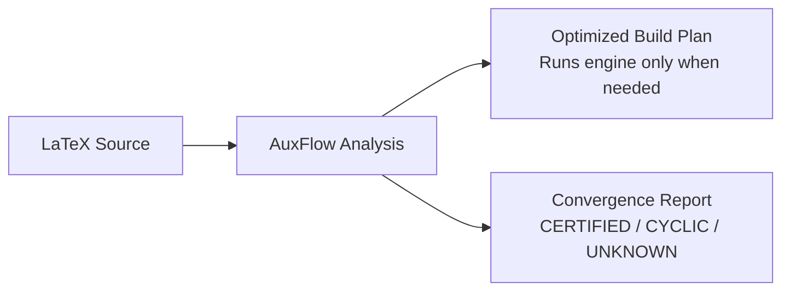

# AuxFlow

A compiler and static analysis tool for LaTeX documents.

[](https://pypi.org/project/auxflow/) [](https://pypi.org/project/auxflow/)

LaTeX documents often compile multiple times to settle page numbers, tables of contents, and citations.
Standard tools rerun the engine until auxiliary files stop changing.
AuxFlow inspects your code upfront, finds reference loops, and calculates the exact compile passes needed.



---

## Installation

Install using `pipx` (recommended):

```bash
pipx install auxflow
```

Or install with `pip`:

```bash
pip install auxflow
```

Requires Python 3.12 or newer.

---

## Quick Start

Check a document for broken references and syntax errors:

```bash
auxflow check document.tex
```

Find the number of compile passes needed:

```bash
auxflow classify document.tex
```

Build the document with automatic verification:

```bash
auxflow run document.tex
```

---

## Document States

AuxFlow assigns every document one of four convergence states:

| State | What it means |
|:---|:---|
| **CERTIFIED** | Stable reference structure. Needs a fixed number of runs. |
| **BENIGN_CYCLIC** | Loops exist, but do not change content length. Settles safely. |
| **AMPLIFYING** | Loops trigger infinite page growth. Refused by default. |
| **UNKNOWN** | Uses packages outside the supported subset. Uses safe default runs. |

---

## Documentation

Browse the sections in the sidebar:

- **[Reference](/reference/)**: Compiler phases, supported LaTeX subset, and dependency graph models.
- **[Project](/project/)**: Formal specification, research questions, and literature comparison.
- **[Evaluation](/evaluation/)**: 15-document benchmark corpus, test setup, and experimental results.
- **[Reviews](/reviews/)**: Viva defense notes, slide presentations, and assessment documents.
- **[Changelog](/changelog.html)**: Interactive release notes and update history.
