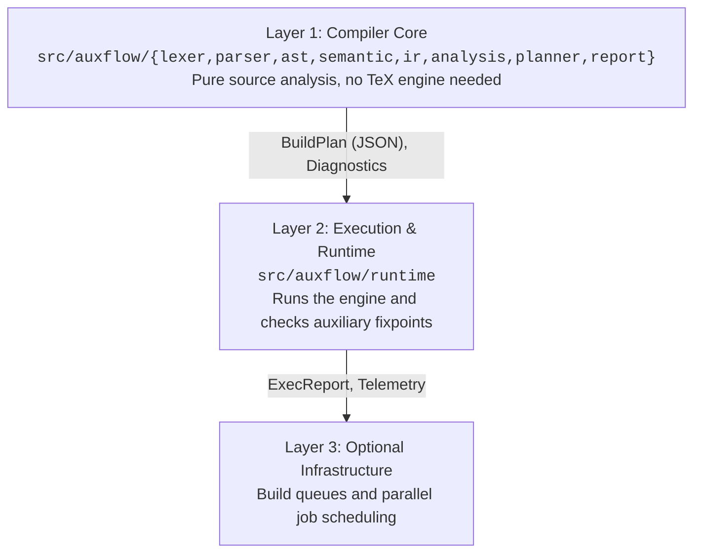
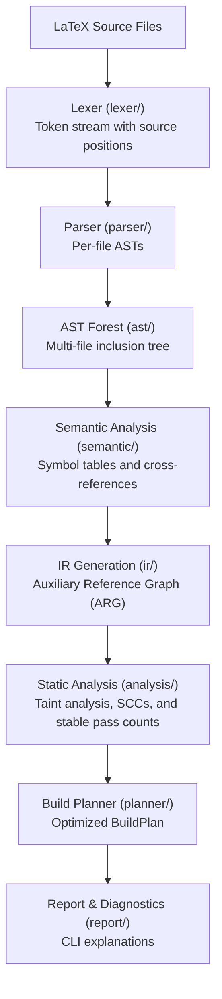
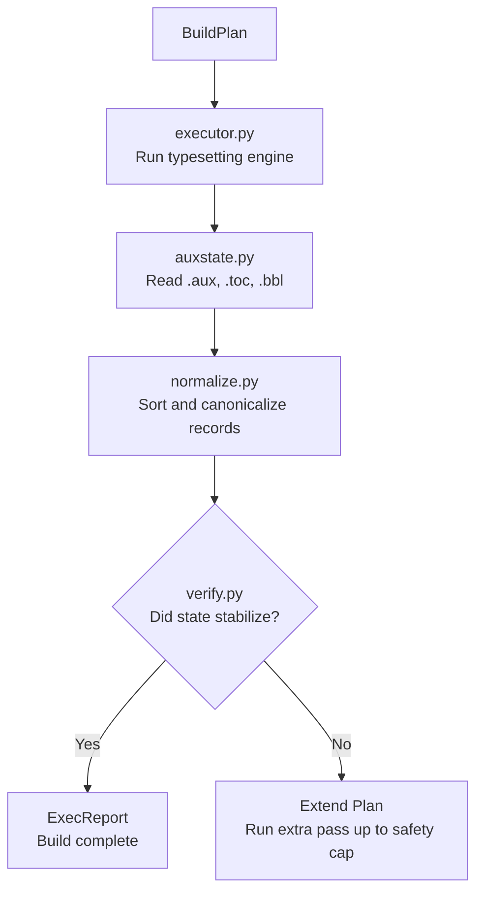

# Architecture

Three layers, in strict dependency order. Each layer may depend only on layers above it.

**The load-bearing invariant: layer 1 is a complete project.** Delete layers 2 and 3 and what
remains is a compiler with a lexer, parser, AST, symbol tables, semantic analysis, an IR, two
dataflow analyses, a classifier and code generation. That property is not incidental; it is the
reason the layering is enforced.

## Layer 1 — compiler core

Constraints on layer 1:

- No module imports anything from `runtime/`.
- No module executes a subprocess.
- The only filesystem access is reading source files named by `\input`, `\include`,
  `\includegraphics` and `\bibliography`, plus stat calls to check existence.
- Analysis modules operate on the ARG only. They must not reach back into the AST. If an
  analysis needs AST information, that information belongs in the IR — this rule is what keeps
  the ARG an honest intermediate representation rather than a decorated index into the tree.

## Layer 2 — execution and runtime

Layer 2 exists to answer one question the compiler cannot: *was the prediction right?* It never
influences the analysis at run time. Telemetry it produces may be used offline to improve the
model, but there is no feedback path inside a single invocation.

## Layer 3 — optional infrastructure

Not present in this repository. Specified in
[FUTURE-INFRASTRUCTURE.md](https://github.com/upayanmazumder/auxflow/blob/main/docs/FUTURE-INFRASTRUCTURE.md) so that the design is on record, and
deliberately unimplemented so that it cannot consume MVP effort.

## Command-line surface

One entry point, one subcommand per phase, so that each compiler phase is independently
demonstrable and independently testable.

| Command | Layer | Output |
|---|---|---|
| `auxflow tokens FILE` | 1 | token stream |
| `auxflow ast FILE` | 1 | pretty-printed AST forest |
| `auxflow symbols FILE` | 1 | symbol table dump |
| `auxflow check FILE` | 1 | semantic diagnostics, exit non-zero on error |
| `auxflow graph FILE -o G.dot` | 1 | ARG in Graphviz DOT |
| `auxflow classify FILE [-v] [--force]` | 1 | classification with diagnosis |
| `auxflow plan FILE [--explain] [--force]` | 1 | BuildPlan JSON or explained steps |
| `auxflow run [--force] [--strict] FILE` | 2 | execute the plan and print ExecReport JSON |

`auxflow ast FILE` reads reachable `\input` and `\include` files. It resolves
relative names from each source file and adds `.tex` when a name has no suffix.
The output lists each file once and reports inclusion cycles.
Phase 6 reports missing inclusions as semantic diagnostics.

`auxflow symbols FILE` uses the same forest. It prints all six tables in a
fixed order, with keys sorted within each table.

`auxflow check FILE` reads the same forest and prints diagnostics with source
spans and severity. Errors produce exit status 1. Warnings alone produce 0.

`auxflow classify FILE` runs declaration, resolution, lowering, taint, SCC,
condensation, and stable-pass, then prints the matching report block.
Exit status is 1 only for `AMPLIFYING` without `--force`; every other
state, and `AMPLIFYING` with `--force`, exits 0. `-v`/`--verbose` is
required to print a `BENIGN_CYCLIC` report; it is silent otherwise.

`auxflow plan FILE` emits a JSON BuildPlan with source diagnostics and step
reasons. `--explain` prints the step order and each reason instead of JSON.
For `AMPLIFYING`, it prints the diagnosis and exits 1 without a plan.
`--force` emits a capped, conservative plan instead.

`auxflow run` classifies, plans, and executes in the source directory.
It preserves external tool output and prints a JSON execution report last.
The report includes `status`, `stop_condition`, `runs`, and `prediction_miss`.
It exits non-zero on tool failures, missing inputs, an exceeded cap,
`AMPLIFYING` without `--force`, or `UNKNOWN` with `--strict`.
For an amplifying refusal, it also prints the cycle diagnosis.

Every command up to and including `plan` runs without a TeX engine installed. This is a hard
requirement, and it is what makes the compiler independently gradeable.

## Data contracts between layers

| Contract | Producer | Consumer | Form |
|---|---|---|---|
| `BuildPlan` | planner | executor | JSON, versioned by `model_version` |
| `Diagnostic` | semantic, analysis | report | structured record with `Span` and error or warning severity |
| `AuxState` | executor | verifier | canonical set of records |
| `ExecReport` | executor | harness | JSON, one per run |

`BuildPlan` is the only interface between layer 1 and layer 2, and it is serialisable. That
means the analysis can be run on one machine and the execution on another, which is the entire
technical basis for the stretch work in layer 3 — and the reason no part of layer 3 needs to
exist for the design to be complete.

## Error handling posture

- **Unsupported source construct** — not an error. Produces an opacity marker, downgrades the
  classification, never aborts. See [LANGUAGE-SUBSET.md](/reference/language-subset.html).
- **Malformed source** (unbalanced braces, unterminated environment) — a diagnostic with a span;
  parsing continues in recovery mode so that a single defect does not suppress all later output.
- **Missing included file** — a diagnostic; the file's facts become unknown.
- **Engine failure at runtime** — abort, surface the engine log unmodified.
- **Internal invariant violation** — crash loudly. Never degrade silently.
